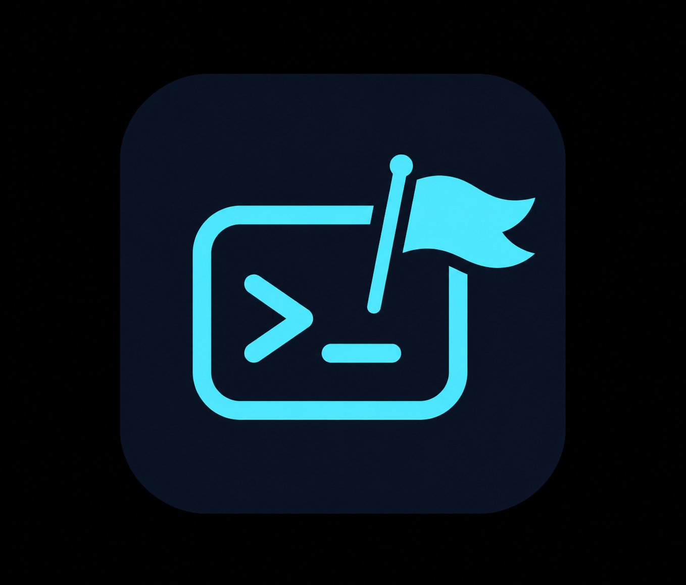

<p align="center">
  
</p>

<h1 align="center">RIK0SEC CTF QUICK LAUNCHER</h1>

<p align="center">
  A Modular Toolkit for CTF & Cybersecurity Learning
</p>
# Rik0Sec CTF Quick Launcher

**Rik0Sec CTF Quick Launcher** adalah aplikasi CLI berbasis Python untuk membantu pelajar dan pemula memilih pemeriksaan yang relevan saat mengerjakan **Capture The Flag (CTF)**, praktikum, dan lab keamanan siber yang memang diizinkan.

Launcher mengelompokkan pemeriksaan berdasarkan kategori, mengecek ketersediaan executable pendukung, menampilkan perintah yang akan dijalankan, lalu meminta konfirmasi pengguna.

> **Bukan auto-solver:** launcher tidak otomatis menemukan atau menjamin flag. Pengguna tetap harus memahami soal, memilih analisis yang tepat, dan mengevaluasi hasilnya.

## Fitur

| Menu | Kategori | Contoh |
|---|---|---|
| 1 | Network & PCAP | Ringkasan PCAP, statistik protokol, HTTP, DNS, TCP stream, Nmap untuk target berizin |
| 2 | Cryptography | Base64, Hex, transformasi encoding, RSA textbook, repeating-key XOR, referensi Hashcat JWT |
| 3 | Web & API (manual) | Template curl, decode header/payload JWT, checklist manual, membuka Burp Suite |
| 4 | Linux & SUID | Audit SUID, permission file, Linux capabilities, permission path |
| 5 | Forensics & files | Identifikasi tipe file, metadata, strings, Binwalk, hex dump |
| 6 | Logs & incident response | Pencarian pola log, riwayat login, listening sockets, journal |
| 7 | Firewall & ACL | Membaca iptables, nftables, UFW, dan Linux File ACL (`getfacl`) |
| 8 | Cek semua tools | Memeriksa executable pendukung yang ditemukan di `PATH` |

### Catatan penting tentang Firewall & ACL

Menu ini bersifat **read-only**: perintah yang disediakan hanya membaca/menampilkan konfigurasi, bukan menambah, mengubah, atau menghapus aturan.

- `iptables -L -n -v --line-numbers`
- `nft list ruleset`
- `ufw status verbose`
- `getfacl -p <path>`

Pemeriksaan firewall dapat membutuhkan hak akses root. Jika muncul `Permission denied` atau `Operation not permitted`, itu tidak berarti launcher rusak. Jangan menjalankan seluruh launcher sebagai root hanya untuk satu pemeriksaan; gunakan elevasi hak akses secara sadar dan seperlunya. Linux File ACL mengatur akses file/direktori, sedangkan firewall mengatur lalu lintas jaringan.

## Persyaratan

- Python **3.9 atau lebih baru**.
- Linux direkomendasikan; Kali Linux merupakan lingkungan yang paling sesuai untuk mencoba kumpulan tools keamanan.
- Tidak ada dependency Python pihak ketiga. `requirements.txt` hanya menjelaskan bahwa project menggunakan standard library.
- Tools eksternal bersifat opsional. Pasang hanya tools untuk kategori yang ingin digunakan.

## Instalasi dan menjalankan

### Kali Linux / Ubuntu

Pastikan Python dan Git tersedia:

```bash
sudo apt update
sudo apt install -y python3 git
```

Clone repository (ganti `USERNAME` dengan nama akun GitHub pemilik repository):

```bash
git clone https://github.com/rik0sec/rik0sec-ctf-quick-launcher.git
cd rik0sec-ctf-quick-launcher
python3 ctf_quick_launcher.py
```

Atau unduh ZIP dari halaman GitHub, ekstrak, lalu jalankan `python3 ctf_quick_launcher.py` dari folder project.

Tidak perlu menjalankan `pip install -r requirements.txt`.

### Windows 10/11 melalui WSL2

Launcher adalah program CLI Python dan dapat dijalankan di lingkungan Linux pada WSL2. WSL bukan pengganti penuh VM untuk semua eksperimen jaringan atau fitur yang bergantung pada layanan/kernel Linux.

1. Buka **PowerShell** atau **Windows Terminal** sebagai Administrator.
2. Instal WSL dan Ubuntu (jika belum tersedia):

   ```powershell
   wsl --install -d Ubuntu
   ```

3. Restart Windows jika diminta, lalu buka Ubuntu dari Start Menu.
4. Buat username dan password Linux saat pertama kali dijalankan.
5. Di terminal Ubuntu/WSL:

   ```bash
   sudo apt update
   sudo apt install -y python3 git
   git clone https://github.com/rik0sec/rik0sec-ctf-quick-launcher.git
   cd rik0sec-ctf-quick-launcher
   python3 ctf_quick_launcher.py
   ```

Jika WSL sudah terpasang, cukup buka distro Linux yang digunakan dan jalankan langkah instalasi paket serta clone di atas. Untuk Kali di WSL, distro dapat dipasang melalui instruksi resmi Kali/WSL; Ubuntu biasanya merupakan pilihan awal paling sederhana.

**Batasan WSL:** akses ke antarmuka jaringan, capture paket, system journal, firewall host, dan aplikasi GUI Linux dapat berbeda dari instalasi Linux penuh. Tools yang memerlukan perangkat jaringan atau hak istimewa tertentu mungkin tidak berfungsi atau memerlukan konfigurasi tambahan. Jangan menganggap hasil pemeriksaan WSL mewakili firewall Windows.

### VirtualBox dengan Kali Linux / Ubuntu

Untuk pengalaman lab yang lebih terisolasi dan perilaku Linux yang lebih mendekati instalasi penuh, gunakan VM:

1. Instal Oracle VirtualBox pada Windows, Linux, atau macOS.
2. Unduh ISO Kali Linux atau Ubuntu dari situs resminya.
3. Buat VM baru dan pasang sistem operasi dari ISO.
4. Setelah masuk ke desktop VM, buka terminal.
5. Instal kebutuhan dasar, clone repository, lalu jalankan:

   ```bash
   sudo apt update
   sudo apt install -y python3 git
   git clone https://github.com/rik0sec/rik0sec-ctf-quick-launcher.git
   cd rik0sec-ctf-quick-launcher
   python3 ctf_quick_launcher.py
   ```

Gunakan **NAT** untuk akses internet biasa. Untuk latihan komunikasi antar-VM, gunakan jaringan **Host-only** atau **Internal Network** sesuai desain lab. Hindari Bridged Adapter untuk eksperimen yang dapat menjangkau jaringan nyata kecuali benar-benar memahami risikonya dan memiliki izin.

## Tools eksternal

Launcher tidak memasang tools secara otomatis. Menu 8 dapat digunakan untuk melihat executable yang ditemukan. Contoh paket di Kali/Debian (nama paket dapat berbeda antar-distro):

```bash
sudo apt install -y tshark wireshark tcpdump nmap \
  openssl hashcat john curl burpsuite \
  exiftool binwalk xxd acl nftables iptables ufw
```

Daftar di atas hanya contoh, bukan persyaratan wajib dan tidak semua paket harus dipasang. Beberapa tools seperti `last` dapat berasal dari paket yang berbeda tergantung versi distro. Pasang sesuai kebutuhan dan periksa ketersediaannya melalui menu 8.

## Cara penggunaan singkat

1. Jalankan `python3 ctf_quick_launcher.py`.
2. Pilih kategori berdasarkan deskripsi soal.
3. Masukkan path file atau parameter yang diminta.
4. Periksa perintah dan target yang ditampilkan.
5. Ketik `y` untuk menjalankan; tekan Enter atau `n` untuk membatalkan.
6. Analisis output dan validasi temuan berdasarkan bukti.

Panduan lengkap dan contoh per kategori tersedia di **[PANDUAN_PENGGUNA.md](PANDUAN_PENGGUNA.md)**.

## Pengujian

Jalankan smoke test dari direktori project:

```bash
python3 -m unittest discover -s tests -v
```

Test ini mencakup kompilasi, alur keluar menu, dan beberapa pemeriksaan read-only. Lulusnya smoke test bukan jaminan semua kombinasi distro, tools eksternal, dan konfigurasi sistem telah diuji.

## Keamanan dan batas penggunaan

- Gunakan hanya pada CTF, praktikum, sistem milik sendiri, atau lab yang secara eksplisit memberi izin.
- Nmap hanya untuk target yang berada dalam scope dan diizinkan. Jangan melakukan pemindaian jaringan luas tanpa otorisasi.
- Web & API bersifat manual; launcher tidak menjalankan eksploitasi otomatis.
- Decode JWT hanya membaca header dan payload, bukan memverifikasi signature atau keabsahan token.
- Menu Firewall & ACL hanya membaca konfigurasi.
- Sebagian perintah membutuhkan hak akses tambahan. Gunakan hak akses minimum; jangan menjalankan seluruh launcher sebagai root.
- Perintah eksternal meminta konfirmasi dan dipanggil sebagai daftar argumen proses, bukan melalui shell.
- Jangan commit atau mengunggah PCAP, log, token, kredensial, private key, data pribadi, atau flag kompetisi yang tidak boleh dibagikan.

## Struktur project

```text
rik0sec-ctf-quick-launcher/
├── ctf_quick_launcher.py
├── README.md
├── PANDUAN_PENGGUNA.md
├── CHANGELOG.md
├── CONTRIBUTING.md
├── LICENSE
├── requirements.txt
├── .gitignore
├── examples/
└── tests/
```

## Kontribusi

Kontribusi berupa laporan bug, perbaikan kode, dokumentasi, dan pengujian dipersilakan. Baca [CONTRIBUTING.md](CONTRIBUTING.md) sebelum mengirim perubahan.

## Lisensi

Project ini menggunakan lisensi MIT. Lihat [LICENSE](LICENSE).
